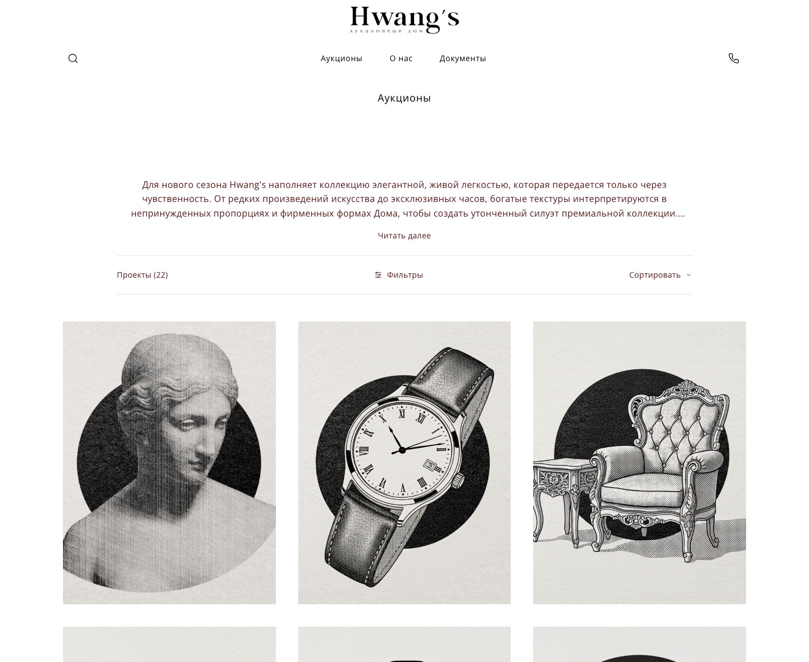
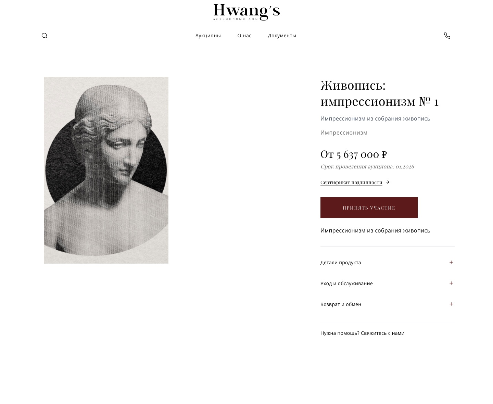
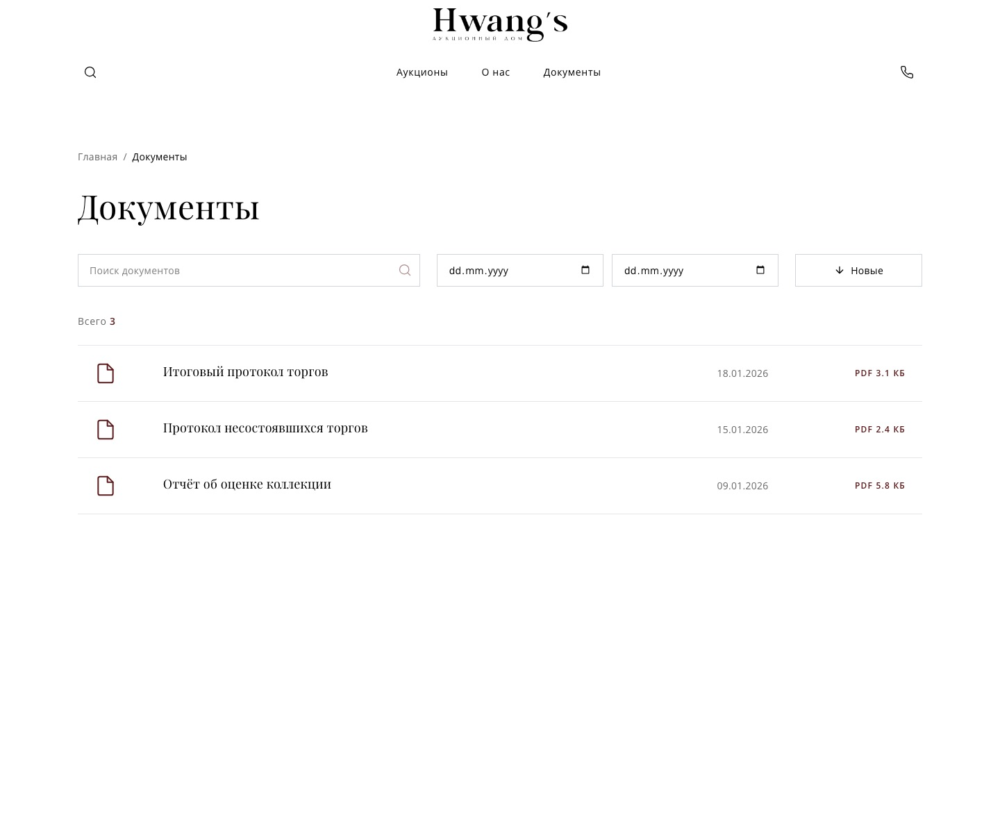

<div align="center">

# Hwang's Auction House

**A luxury auction house on 11 Postgres tables, no ORM, and a demo mode that needs no database.**
Catalogue with a client-side filter engine over 18 categories and 108 lots, lot pages
with certificates, a protocol archive with search and date range, and bidding entry
points that work the moment the repo is cloned.

**Demo:** [hwangs-auction-house.vercel.app](https://hwangs-auction-house.vercel.app)


</div>

## The problem

An auction house sells confidence. A visitor deciding whether to bid on a piece has
to see the catalogue, the provenance, the certificates and the past protocols — and
has to be able to filter all of it without waiting on a server round-trip.

The second problem is institutional: results are public record. Protocol documents
are not an attachment folder, they are a searchable archive with a date range,
because that is how buyers actually check a house.

---


**Demo:** https://hwangs-auction-house.vercel.app — opens without a database. When `DATABASE_URL` is unset the public API answers from the demo catalog in `lib/demo.ts` (18 categories, 108 lots, filters, documents), so the pages, the client-side filter engine and the cart-free bidding flow entry points are all clickable. With a database attached the same routes read Postgres.

<table>
  <tr>
    <td width="50%"></td>
    <td width="50%"></td>
  </tr>
  <tr>
    <td width="50%"></td>
    <td width="50%"></td>
  </tr>
  <tr>
    <td colspan="2" align="center"></td>
  </tr>
</table>

---

## Stack and size

| 13 755 | 47 | 17 | 22 | 11 |
| --- | --- | --- | --- | --- |
| lines of TypeScript | source files | pages | API route handlers | Postgres tables |

Next.js 16 on Turbopack, React 19, TypeScript in strict mode, Tailwind CSS 4, `pg` for data access. No ORM and no UI kit: the design system is the house's own serif scale plus `globals.css`.

## How it is put together

```
app/
  page.tsx            landing: film hero, three editorial panels, category rail
  auctions/           catalog (client-side filtering + sort) and /auctions/[id] lot page
  documents/          protocol archive with search and a date range
  about, faq, cookies, privacy-policy, terms-of-use
  admin/              login, dashboard, editors for lots, categories, filters,
                      documents, homepage and about content, contact requests
  api/
    auctions, auctions/[id], categories, filters, documents   public reads
    contact, newsletter/subscribe                             public writes
    admin/*                                                   guarded by lib/admin.ts
    content/homepage, content/about                           CMS-style JSON blocks
lib/
  db.ts               pg pool, and hasDatabase which switches the demo source
  admin.ts            scrypt password hashing, HMAC-signed session, requireAdmin()
  demo.ts             the no-database catalog the demo serves
db/schema.sql         the whole schema, applied by npm run db:migrate
scripts/              migrate.mjs, seed-catalog.mjs, create-admin.mjs
```

Reads are hand-written SQL with positional parameters; the catalog filters and sorts on the client so that switching sort order does not refetch. Page content that the client edits in the admin panel lives in `homepage_content` / `about_content` as JSON per section, and the pages keep a matching default in their own `useState`, so a missing row degrades to the shipped copy instead of an empty screen.

## What this pass changed

The repository is two commits: `Initial commit: Premium auction house website` plus the `create-next-app` scaffold. Nothing in it had ever been compiled or run against a clean database.

| Item | Before | After |
| --- | --- | --- |
| Type check | `npx tsc --noEmit` reported 6 errors and `next build` stopped on the first of them | clean, `npm run typecheck` is part of the scripts. The errors were real: `certificates` came from `JSON.parse` so it typed as `any` and every `.map` callback was implicit-any, `category_id` was `number` in the interface but `null` in the form, and `fetchAuctions(0, category, 'relevance')` passed a third argument to a two-parameter function, so the sort hint was silently dropped |
| `/auctions` build | `useSearchParams()` outside a Suspense boundary aborted the static export | view moved behind `<Suspense>`, 41 routes build |
| Schema on a fresh database | `initDatabase()` replayed 28 `CREATE`/`ALTER` statements from `lib/db.ts`, and on an empty database it died on the eighth: `ALTER TABLE auctions ADD COLUMN category_id ... REFERENCES auction_categories(id)` ran before `auction_categories` existed. Reproduced with `psql` on a scratch database: `ERROR: relation "auction_categories" does not exist` | `db/schema.sql` in dependency order, `npm run db:migrate` applies it. Verified end to end on an empty database: 11 tables, then `npm run db:seed` writes 18 categories, 108 lots and 3 documents, then `npm run db:admin` creates a login |
| DDL in request handlers | `GET /api/documents` created the table and inserted 9 rows on the first call, and every API handler awaited `initDatabase()` behind a module-level latch | no DDL outside the migration script |
| Public write and wipe endpoints | `GET /api/init-db`, `GET /api/init-full`, `GET /api/init-categories`, `POST /api/auctions/seed` (which runs `DELETE FROM auctions`), `POST /api/documents` and `POST /api/auctions/update-painting-collection1` were all reachable without a session | removed; seeding is a CLI script now |
| Admin session | the cookie value was the literal string `authenticated`, and 12 route handlers compared against it, so `curl -H 'Cookie: admin_session=authenticated'` was an admin login | `lib/admin.ts` issues `username.expiry.nonce.HMAC-SHA256`, checked with `timingSafeEqual`; `requireAdmin()` replaces the 12 copies. Measured: forged cookie 401, issued cookie 200 |
| Admin password | stored in the clear, seeded as `('1','1')`, and login compared it inside SQL (`WHERE username = $1 AND password = $2`) | scrypt hash with a random salt in `password_hash`, verified in Node with a constant-time compare. Measured: wrong password 401, correct 200 |
| Error payloads | three handlers returned `details: error.message` to the browser | generic message only |
| Logging | 27 `console.log` calls, including one per lot per render inside the catalog's filter predicate and a `JSON.stringify` of the homepage content on every request | none |
| Media weight | `public/` was 91 MB: photographs stored at 4000-6000 px wide, category art as PNG, an 8.5 MB hero film, plus 24 MB of admin-uploaded screenshots tracked in git | 9.1 MB. Images resampled to at most 1920 px, photographic PNGs converted to JPEG (paths updated in the two files that referenced them), the film re-encoded to 1.1 MB at 1280 px, uploads ignored |
| Docs | the README described Prisma, which is not a dependency, and told you to copy a `.env.example` that did not exist; eight internal runbooks and a startup instruction in Russian sat in the root | rewritten around what is actually in the tree, `.env.example` added, internal documents removed |

## Run it

```bash
npm install
cp .env.example .env            # DATABASE_URL, ADMIN_SESSION_SECRET
npm run db:migrate              # applies db/schema.sql
npm run db:seed                 # 18 categories, 108 demo lots
ADMIN_USERNAME=admin ADMIN_PASSWORD='at least 12 chars' npm run db:admin
npm run dev                     # http://localhost:3000
```

Without `DATABASE_URL` the app still starts and the public pages run on the demo catalog; the admin panel needs a database.

## Data model

`auctions` carries the lot itself plus `certificates`, `detail_sections` and `filter_values` as JSONB, and links to `auction_categories` through `category_id`. Filters are data, not code: `filters` rows (`checkbox` | `range` | `text`) with `filter_options` for the checkbox kind, scoped per category, and the catalog UI builds its rail from them. `documents`, `homepage_content`, `about_content`, `newsletter_subscriptions`, `contact_requests` and `admin_users` complete the set.

## Known limits

- Filtering and sorting happen in the browser over one fetched page of lots, so a category larger than `ITEMS_PER_PAGE` filters within what is loaded rather than across the whole set.
- The demo catalog is generated: names are `Категория: подкатегория № N` and prices come from a seeded formula, not from the house's real lots.
- Lots, certificates and documents in the repository are the client's; the images are the ones the site ships.
- No bidding, no payments, no user accounts: the site is a catalog and a protocol archive, and interest is expressed through the contact form.
- `contact_requests` rows are deleted by the admin list after 24 hours, so the table is an inbox, not an archive.

## Коротко по-русски

Аукционный дом предметов роскоши: Next.js 16 на Turbopack, React 19, Tailwind 4, доступ к Postgres через `pg` без ORM. Каталог, карточка лота с сертификатами и секциями деталей, архив протоколов с поиском по датам, админка, которая правит и лоты, и тексты главной страницы.

Репозиторий был в два коммита и ни разу не собирался. `tsc` давал шесть ошибок, а `next build` валился на пререндере `/auctions` из-за `useSearchParams` без границы `Suspense`. Схема поднималась прямо из обработчиков: 28 запросов `CREATE`/`ALTER` из `lib/db.ts`, и на чистой базе это умирало на восьмом, потому что `ALTER TABLE auctions ... REFERENCES auction_categories(id)` шёл раньше создания `auction_categories`. Я это воспроизвёл на отдельной базе и вынес схему в `db/schema.sql` с скриптами `db:migrate`, `db:seed`, `db:admin` — проверено на пустой базе: 11 таблиц, 18 категорий, 108 лотов.

Главное в смысле безопасности: сессия администратора была строка `authenticated` в cookie, и двенадцать роутов сравнивали с ней значение, то есть любой `curl` становился админом. Плюс открытые `GET /api/init-*` и `POST /api/auctions/seed` с `DELETE FROM auctions`, и пароль админа в открытом виде, заведённый как `1`/`1`. Сессию перевёл на HMAC-подпись с сроком и `timingSafeEqual`, пароль на scrypt, проверку в один `requireAdmin()`, сидинг в CLI. Замерено: подделанная cookie 401, выпущенная 200; неверный пароль 401, верный 200.

Медиа весило 91 МБ (фото по 4000-6000 пикселей, PNG там, где достаточно JPEG, фильм 8,5 МБ и 24 МБ загруженных скриншотов в истории) — стало 9,1 МБ. README переписан: он описывал Prisma, которого в зависимостях нет, и советовал копировать несуществующий `.env.example`. Без `DATABASE_URL` приложение теперь открывается на демо-каталоге из `lib/demo.ts`, поэтому витрину можно смотреть целиком, не поднимая базу.

## Rights

© 2026 Nikita Koreshkov. Portfolio piece, all rights reserved. The Hwang's name, logotype, photography, lot data and auction protocols belong to the auction house.
